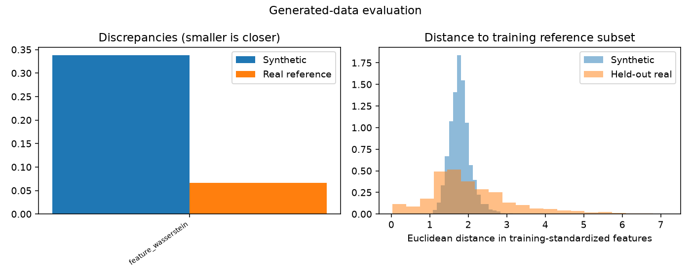

# Generative modeling evaluation

Evaluation mode: **validation**

Evaluation of saved training outputs.

AI interpretation: completed

Quality screens are predefined heuristics. Statistical similarity does not establish biological validity or privacy.

## image_gan

Decision: **insufficient_evidence**

The validation interval does not establish an improvement. These are development findings; a frozen final assessment is pending. Quality flags do not prove universal unusability.

Validity: passed

Output domain: image

Coverage of original plan: executable_contract_v2

Observed samples: {'training_reference': 4096, 'holdout': 1024, 'generated': 2048}

#### Model-fit diagnostics

History: available; epochs observed: 6.

| Diagnostic | First | Last | Minimum (epoch) | Recent change |
|---|---:|---:|---:|---:|
| generator_loss | 2.6153 | 1.1249 | 1.1249 (6) | -0.7261 |
| discriminator_loss | 0.29732 | 0.56794 | 0.29732 (1) | 0.15569 |
| validation_feature_wasserstein | 0.74353 | 0.49725 | 0.3891 (2) | 0.10816 |

Recent change compares the last two to five available observations; it is not a significance test. Minima of GAN losses are descriptive, not optimal-quality checkpoints.


- Adversarial losses describe optimization, not sample quality. Their relative magnitudes do not diagnose discriminator dominance or mode collapse.
- Recent changes are descriptive, not significance tests. Improved model fit does not establish improved samples or downstream benefit.

### Sample-quality evidence

Threshold flags are exploratory workflow controls, not calibrated scientific acceptance boundaries.

| Discrepancy | Synthetic | Bootstrap 95% interval | Real-reference median (range) | Ratio | Exploratory flag |
|---|---:|---|---|---:|---|
| feature_wasserstein | 0.33832 | [0.30454207097202324, 0.3900295982846253] | 0.066535 ([0.06131994322526194, 0.09589018958282036]) | 5.0848 | fail |

Diversity ratio: 0.6067093341781349
Exact training-subset duplicate fraction: 0.0



Per-class results (small classes may be unassessable):

```json
{
  "0": {
    "status": "computed",
    "n": 106,
    "synthetic_discrepancy": 0.2670236089440429,
    "reference_median": 0.07524494329837,
    "diversity_ratio": 0.8605741339691145,
    "screen_passed": false
  },
  "1": {
    "status": "computed",
    "n": 108,
    "synthetic_discrepancy": 1.3074285612518293,
    "reference_median": 0.3025165460116618,
    "diversity_ratio": 0.3310581886249222,
    "screen_passed": false
  },
  "2": {
    "status": "computed",
    "n": 118,
    "synthetic_discrepancy": 0.2781081030456694,
    "reference_median": 0.11922058480259395,
    "diversity_ratio": 0.6799701322530081,
    "screen_passed": false
  },
  "3": {
    "status": "computed",
    "n": 118,
    "synthetic_discrepancy": 0.2177918161959921,
    "reference_median": 0.07294433451220209,
    "diversity_ratio": 0.7877204903224614,
    "screen_passed": false
  },
  "4": {
    "status": "computed",
    "n": 91,
    "synthetic_discrepancy": 0.27796181488057387,
    "reference_median": 0.11970703541303447,
    "diversity_ratio": 0.8145399548162852,
    "screen_passed": false
  },
  "5": {
    "status": "computed",
    "n": 139,
    "synthetic_discrepancy": 0.3183688116863291,
    "reference_median": 0.12252681537446168,
    "diversity_ratio": 0.6227141388872457,
    "screen_passed": false
  },
  "6": {
    "status": "computed",
    "n": 90,
    "synthetic_discrepancy": 0.5013286259799479,
    "reference_median": 0.13350660993543684,
    "diversity_ratio": 0.6842896019582451,
    "screen_passed": false
  },
  "7": {
    "status": "computed",
    "n": 107,
    "synthetic_discrepancy": 0.2745826416164938,
    "reference_median": 0.08084068420023766,
    "diversity_ratio": 0.8512499677127194,
    "screen_passed": false
  },
  "8": {
    "status": "computed",
    "n": 147,
    "synthetic_discrepancy": 0.34122804783393124,
    "reference_median": 0.10964538388853101,
    "diversity_ratio": 0.4538771003322087,
    "screen_passed": false
  }
}
```

### Spatial and texture assessment

Local gradient magnitude mean/std on a 4x4 grid, and up to 32 PCA components of full RGB pixels. Both scalers and PCA fit real training only.

| Feature space | Energy discrepancy | Bootstrap 95% interval | Real-reference median (range) |
|---|---:|---|---|
| texture | 3.2471 | [3.048639887102888, 3.519125474933824] | 0.044035 ([0.03483515045565255, 0.1587376201824977]) |
| pixel_pca | 3.4248 | [3.314593960781226, 3.5886448580897983] | 0.029334 ([0.025997031787991176, 0.03698080557234995]) |

No acceptance cutoff is assigned. Reference ranges are not confidence intervals. These are not FID or histology-validity scores.

### Visual inspection

Review status: not_yet_reviewed. See [image_gan sample packet](image_gan/visual_review.md). Figure preparation does not establish visual realism.

### Downstream comparison

real-only vs real+synthetic; class-matched real-resampling augmentation control included

Macro-F1: baseline 0.6337; alternative 0.6289.
Difference: -0.0047; paired 95% bootstrap interval [-0.019491028412360865, 0.015511366934664032].
Evaluated on **validation**. Class-stratified resampling of held-out observations only; excludes training-seed uncertainty.

| Class | Real-only/baseline recall | Alternative recall |
|---|---:|---:|
| 0 | 0.9057 | 0.9057 |
| 1 | 0.8519 | 0.8426 |
| 2 | 0.4915 | 0.4746 |
| 3 | 0.8559 | 0.8220 |
| 4 | 0.5604 | 0.5934 |
| 5 | 0.6331 | 0.6331 |
| 6 | 0.4222 | 0.3444 |
| 7 | 0.3832 | 0.4486 |
| 8 | 0.6190 | 0.6190 |

Synthetic augmentation minus real-resampling control macro-F1: -0.0274; paired interval [-0.04940633135309538, -0.006157770250402288].

### AI interpretation

Structural validity passed for 2,500 uint8 RGB images of shape 28×28×3; this establishes format validity only. Sample-quality measurements indicate mismatch: feature Wasserstein discrepancy was 0.3383 versus a real-reference median of 0.0665, and the diversity ratio was 0.6067. All nine class screens flagged concerns, with particularly low diversity ratios for classes 1 and 8. Texture and pixel-PCA discrepancies were 3.2471 and 3.4248, respectively, versus real-reference medians of 0.0440 and 0.0293; these describe differences in the selected representations and have no acceptance cutoff. Across six training epochs, generator loss decreased and discriminator loss increased, while validation feature Wasserstein reached its minimum at epoch 2 and subsequently worsened, although it finished below its initial value. These optimization trends do not establish a cause for the sample-quality findings or prove collapse. Downstream validation macro-F1 changed from 0.63366 to 0.62892 with synthetic augmentation: delta −0.00473, paired bootstrap 95% CI [−0.01949, 0.01551], which does not establish improvement or deterioration against real-only training. Real-resampling augmentation improved macro-F1 by 0.02269, CI [0.00858, 0.03839]; synthetic augmentation underperformed that control by 0.02743, CI [−0.04941, −0.00616], conditional on the evaluated training runs. Recall changes were mixed across classes. These results justify exploratory model development and controlled augmentation research, but do not establish a downstream benefit from this generator. Failed heuristic screens do not establish universal unusability.

- These are development validation results; a frozen final assessment is pending. Utility bootstrap intervals resample held-out observations and exclude training-seed uncertainty.
- Quality bootstrap intervals condition on one fitted generator. Heuristic screens are exploratory, and reference ranges are not confidence intervals or calibrated acceptance guarantees.
- Image features are not a validated histology representation; similarity or discrepancy in these features does not establish biological or clinical usefulness.
- The visual packet is prepared but not yet reviewed; no images were inspected for this interpretation.
- Zero measured near matches and exact duplicates apply only to the recorded training-reference subset and do not establish privacy.
- Validity reports 2,500 observations, while counts.generated reports 2,048; quality comparisons use 512 matched samples. These differing scopes require reconciliation before assuming a common evaluation population.
- Adversarial losses and six-epoch trends do not independently establish model fit, convergence of the generator, discriminator dominance, or mode collapse.

### Limitations

- Subsampling caps and selected gene panels limit the scope of conclusions.
- Nearest-neighbor checks cover only the training reference subset and cannot establish privacy.
- Bootstrap intervals condition on one trained model and classifier fit; training variability is not included.
- Quality thresholds are heuristic; biological or perceptual validity requires additional evidence.

## Reproducibility

See evaluation_results.json, protocol.json, per-model evaluation_indices.npz and fitted_signature.txt for evidence, sample selection and frozen fitting signatures. Metric definitions and thresholds are in the recorded contract. No training files were overwritten.
