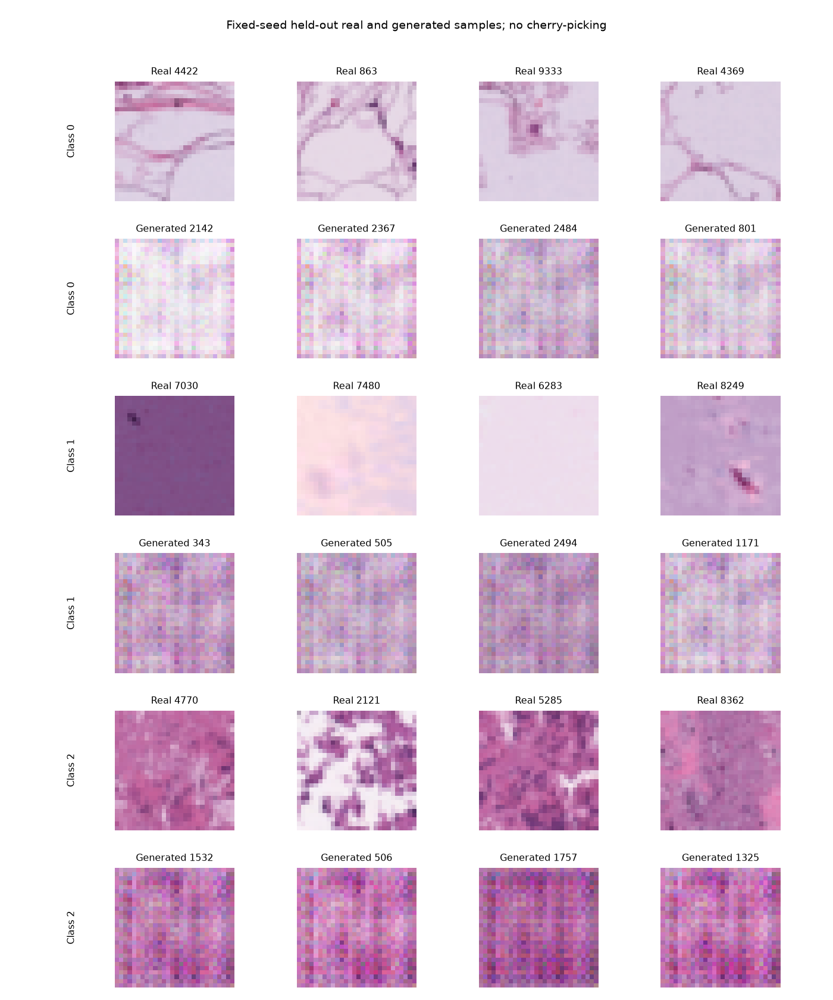
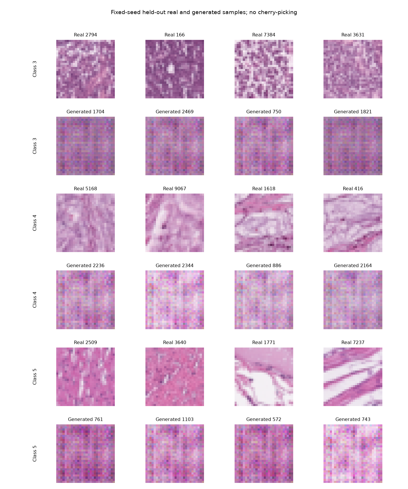
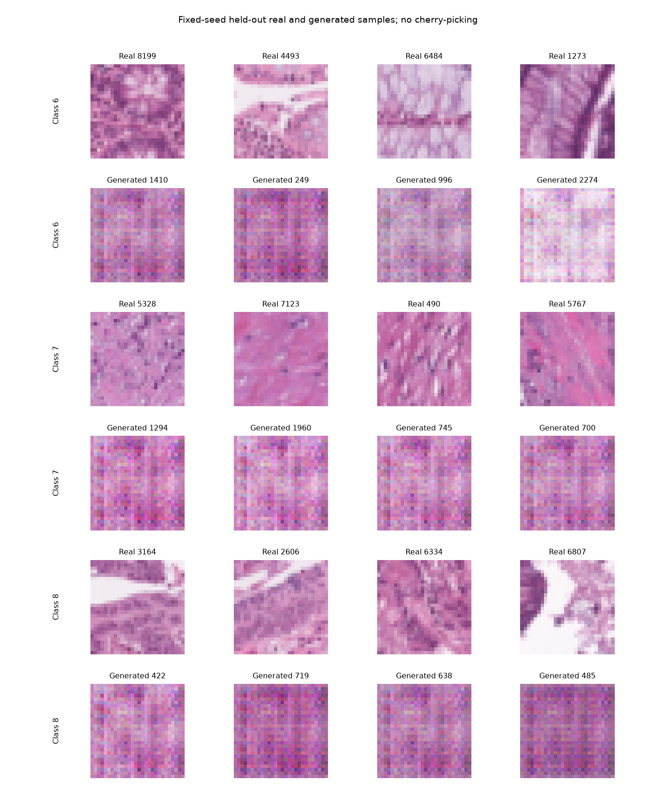

# Visual review packet

Status: not yet reviewed. Figure generation alone is not visual inspection.

- Compare color and stain appearance.
- Inspect fine texture, blur and repeated patterns.
- Compare diversity within each class.
- Do not infer tissue-label correctness or clinical validity without appropriate expertise.
