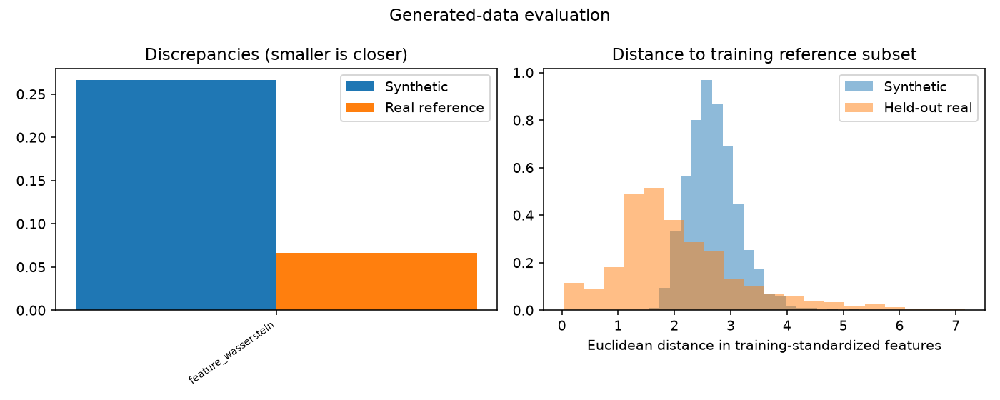
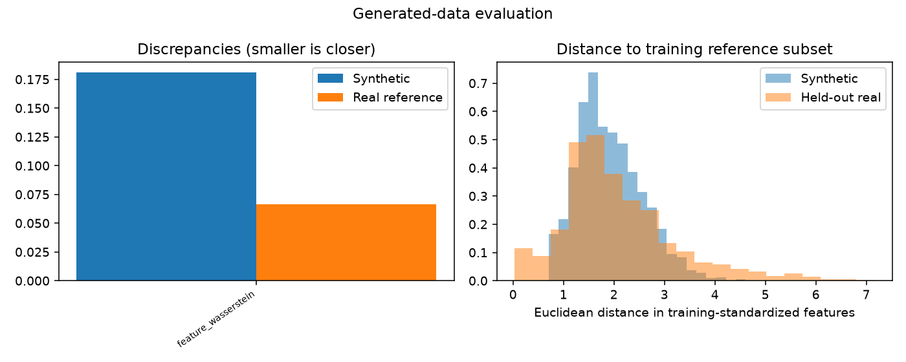

# Generative modeling evaluation

Evaluation mode: **validation**

Evaluation of saved training outputs.

AI interpretation: completed

Quality screens are predefined heuristics. Statistical similarity does not establish biological validity or privacy.

## image_vae

Decision: **insufficient_evidence**

The validation comparison favors the baseline. These are development findings; a frozen final assessment is pending. Quality flags do not prove universal unusability.

Validity: passed

Output domain: image

Coverage of original plan: executable_contract_v2

Observed samples: {'training_reference': 4096, 'holdout': 1024, 'generated': 2048}

#### Model-fit diagnostics

History: available; epochs observed: 17.

| Diagnostic | First | Last | Minimum (epoch) | Recent change |
|---|---:|---:|---:|---:|
| train_negative_elbo | -2035.7 | -2539.4 | -2539.4 (17) | -12.94 |
| validation_negative_elbo | -2277.4 | -2516.7 | -2518.3 (13) | 1.5565 |
| train_reconstruction_nll | -2064.2 | -2573.9 | -2573.9 (17) | -13.741 |
| validation_reconstruction_nll | -2307.4 | -2551.4 | -2551.7 (13) | 0.35773 |
| train_kl | 28.559 | 34.544 | 28.559 (1) | 0.80178 |
| validation_kl | 29.956 | 34.687 | 29.63 (4) | 1.1988 |

Recent change compares the last two to five available observations; it is not a significance test. Minima of GAN losses are descriptive, not optimal-quality checkpoints.

- **possible_overfitting**: Training objective decreased while validation objective increased over the recent window. This is compatible with overfitting, not proof of its cause. Consider a controlled capacity or optimization change; do not simply extend identical training.

- ELBO, reconstruction NLL and KL describe model fit. Low KL can motivate posterior-collapse investigation but no universal KL cutoff is used.
- Recent changes are descriptive, not significance tests. Improved model fit does not establish improved samples or downstream benefit.

### Sample-quality evidence

Threshold flags are exploratory workflow controls, not calibrated scientific acceptance boundaries.

| Discrepancy | Synthetic | Bootstrap 95% interval | Real-reference median (range) | Ratio | Exploratory flag |
|---|---:|---|---|---:|---|
| feature_wasserstein | 0.26644 | [0.2234978221260208, 0.33299730252012494] | 0.066535 ([0.06131994322526194, 0.09589018958282036]) | 4.0046 | fail |

Diversity ratio: 0.7916981908944399
Exact training-subset duplicate fraction: 0.0



Per-class results (small classes may be unassessable):

```json
{
  "0": {
    "status": "computed",
    "n": 106,
    "synthetic_discrepancy": 1.292586875001339,
    "reference_median": 0.07524494329837,
    "diversity_ratio": 1.397270576980494,
    "screen_passed": false
  },
  "1": {
    "status": "computed",
    "n": 108,
    "synthetic_discrepancy": 1.1742526478483912,
    "reference_median": 0.3025165460116618,
    "diversity_ratio": 0.4903298048360735,
    "screen_passed": false
  },
  "2": {
    "status": "computed",
    "n": 118,
    "synthetic_discrepancy": 0.218269584562308,
    "reference_median": 0.11922058480259395,
    "diversity_ratio": 1.0869670776580849,
    "screen_passed": false
  },
  "3": {
    "status": "computed",
    "n": 118,
    "synthetic_discrepancy": 0.3443441967392297,
    "reference_median": 0.07294433451220209,
    "diversity_ratio": 1.4895053196030805,
    "screen_passed": false
  },
  "4": {
    "status": "computed",
    "n": 91,
    "synthetic_discrepancy": 0.4620047163910908,
    "reference_median": 0.11970703541303447,
    "diversity_ratio": 1.1986112962670388,
    "screen_passed": false
  },
  "5": {
    "status": "computed",
    "n": 139,
    "synthetic_discrepancy": 0.2652781004660204,
    "reference_median": 0.12252681537446168,
    "diversity_ratio": 1.109014694334832,
    "screen_passed": false
  },
  "6": {
    "status": "computed",
    "n": 90,
    "synthetic_discrepancy": 0.15637815255033533,
    "reference_median": 0.13350660993543684,
    "diversity_ratio": 0.8900992558961486,
    "screen_passed": false
  },
  "7": {
    "status": "computed",
    "n": 107,
    "synthetic_discrepancy": 0.29299077022507963,
    "reference_median": 0.08084068420023766,
    "diversity_ratio": 1.3696214525688544,
    "screen_passed": false
  },
  "8": {
    "status": "computed",
    "n": 147,
    "synthetic_discrepancy": 0.2395708828347241,
    "reference_median": 0.10964538388853101,
    "diversity_ratio": 0.911031676382049,
    "screen_passed": false
  }
}
```

### Spatial and texture assessment

Local gradient magnitude mean/std on a 4x4 grid, and up to 32 PCA components of full RGB pixels. Both scalers and PCA fit real training only.

| Feature space | Energy discrepancy | Bootstrap 95% interval | Real-reference median (range) |
|---|---:|---|---|
| texture | 13.111 | [12.159530969641338, 14.206413376573108] | 0.044035 ([0.03483515045565255, 0.1587376201824977]) |
| pixel_pca | 0.082266 | [0.09731433547740558, 0.12491331605762233] | 0.029334 ([0.025997031787991176, 0.03698080557234995]) |

No acceptance cutoff is assigned. Reference ranges are not confidence intervals. These are not FID or histology-validity scores.

### Visual inspection

Review status: not_yet_reviewed. See [image_vae sample packet](image_vae/visual_review.md). Figure preparation does not establish visual realism.

### Downstream comparison

real-only vs real+synthetic; class-matched real-resampling augmentation control included

Macro-F1: baseline 0.6337; alternative 0.5863.
Difference: -0.0474; paired 95% bootstrap interval [-0.06814145855922348, -0.025146126711955697].
Evaluated on **validation**. Class-stratified resampling of held-out observations only; excludes training-seed uncertainty.

| Class | Real-only/baseline recall | Alternative recall |
|---|---:|---:|
| 0 | 0.9057 | 0.8113 |
| 1 | 0.8519 | 0.8889 |
| 2 | 0.4915 | 0.4576 |
| 3 | 0.8559 | 0.7966 |
| 4 | 0.5604 | 0.5714 |
| 5 | 0.6331 | 0.6475 |
| 6 | 0.4222 | 0.1778 |
| 7 | 0.3832 | 0.3458 |
| 8 | 0.6190 | 0.6463 |

Synthetic augmentation minus real-resampling control macro-F1: -0.0701; paired interval [-0.09235518415554653, -0.046882073428055844].

### AI interpretation

Format validity passed for 2,500 uint8 RGB images; this establishes structural validity only. Sample-quality measurements show feature Wasserstein discrepancy 0.2664 versus real-reference median 0.0665, diversity ratio 0.7917, and exploratory flags in all nine classes. Texture and pixel-PCA energy distances are 13.1106 and 0.0823 versus reference medians 0.0440 and 0.0293, indicating differences in those representations without an acceptance cutoff. Training negative ELBO continued decreasing while validation negative ELBO worsened slightly after its epoch-13 minimum; possible overfitting is a hypothesis, not an established cause of sample or utility results. Synthetic augmentation reduced validation macro-F1 from 0.6337 to 0.5863: delta -0.0474, paired bootstrap 95% CI [-0.0681, -0.0251]. Class-6 recall fell from 0.4222 to 0.1778, while some classes improved descriptively. Real-resampling augmentation reached 0.6564, with delta +0.0227 versus baseline and CI [0.0086, 0.0384]; synthetic augmentation underperformed that control by -0.0701, CI [-0.0924, -0.0469]. These conditional validation comparisons favor retaining the baseline or investigating the resampling control. The generator is supported for exploratory diagnostics and controlled development experiments, with no demonstrated augmentation benefit in this setting.

- Utility intervals resample validation observations conditional on one training run and exclude training-seed variation; a frozen final assessment is pending.
- Quality screens are exploratory and do not establish universal unusability. Image feature comparisons have no acceptance cutoff, their reference ranges are not confidence intervals, and their representations are not validated histology measures.
- The visual packet is prepared but not reviewed; no images were inspected here and no visual, tissue-label or biological validity is established.
- Zero measured near matches and duplicates apply only to the recorded training reference subset and provide no privacy guarantee.
- Validity reports 2,500 observations while counts.generated reports 2,048; quality uses 512 matched samples. These differing scopes require reconciliation before assuming all summaries describe the same sample pool.
- The pixel-PCA point estimate lies below its reported bootstrap interval; the supplied bootstrap result warrants methodological review before precise uncertainty interpretation.

### Limitations

- Subsampling caps and selected gene panels limit the scope of conclusions.
- Nearest-neighbor checks cover only the training reference subset and cannot establish privacy.
- Bootstrap intervals condition on one trained model and classifier fit; training variability is not included.
- Quality thresholds are heuristic; biological or perceptual validity requires additional evidence.

## image_gan

Decision: **insufficient_evidence**

The validation interval does not establish an improvement. These are development findings; a frozen final assessment is pending. Quality flags do not prove universal unusability.

Validity: passed

Output domain: image

Coverage of original plan: executable_contract_v2

Observed samples: {'training_reference': 4096, 'holdout': 1024, 'generated': 2048}

#### Model-fit diagnostics

History: available; epochs observed: 14.

| Diagnostic | First | Last | Minimum (epoch) | Recent change |
|---|---:|---:|---:|---:|
| generator_loss | 2.5889 | 1.3935 | 1.1878 (9) | 0.17669 |
| discriminator_loss | 0.33021 | 0.51298 | 0.33021 (1) | -0.049288 |
| validation_feature_wasserstein | 0.43543 | 0.27895 | 0.25442 (13) | -0.013347 |

Recent change compares the last two to five available observations; it is not a significance test. Minima of GAN losses are descriptive, not optimal-quality checkpoints.


- Adversarial losses describe optimization, not sample quality. Their relative magnitudes do not diagnose discriminator dominance or mode collapse.
- Recent changes are descriptive, not significance tests. Improved model fit does not establish improved samples or downstream benefit.

### Sample-quality evidence

Threshold flags are exploratory workflow controls, not calibrated scientific acceptance boundaries.

| Discrepancy | Synthetic | Bootstrap 95% interval | Real-reference median (range) | Ratio | Exploratory flag |
|---|---:|---|---|---:|---|
| feature_wasserstein | 0.18114 | [0.16636322088348104, 0.23701602903651364] | 0.066535 ([0.06131994322526194, 0.09589018958282036]) | 2.7225 | fail |

Diversity ratio: 0.7915383072567902
Exact training-subset duplicate fraction: 0.0



Per-class results (small classes may be unassessable):

```json
{
  "0": {
    "status": "computed",
    "n": 106,
    "synthetic_discrepancy": 0.2346385994869812,
    "reference_median": 0.07524494329837,
    "diversity_ratio": 0.8402277366915836,
    "screen_passed": false
  },
  "1": {
    "status": "computed",
    "n": 108,
    "synthetic_discrepancy": 0.3310405820247297,
    "reference_median": 0.3025165460116618,
    "diversity_ratio": 0.7409789157903385,
    "screen_passed": false
  },
  "2": {
    "status": "computed",
    "n": 118,
    "synthetic_discrepancy": 0.23472392355712626,
    "reference_median": 0.11922058480259395,
    "diversity_ratio": 0.7303775906000061,
    "screen_passed": false
  },
  "3": {
    "status": "computed",
    "n": 118,
    "synthetic_discrepancy": 0.2361630538931835,
    "reference_median": 0.07294433451220209,
    "diversity_ratio": 0.5857112327604436,
    "screen_passed": false
  },
  "4": {
    "status": "computed",
    "n": 91,
    "synthetic_discrepancy": 0.22869510473798818,
    "reference_median": 0.11970703541303447,
    "diversity_ratio": 0.9102387146941744,
    "screen_passed": false
  },
  "5": {
    "status": "computed",
    "n": 139,
    "synthetic_discrepancy": 0.3131577560938357,
    "reference_median": 0.12252681537446168,
    "diversity_ratio": 0.6419713545382294,
    "screen_passed": false
  },
  "6": {
    "status": "computed",
    "n": 90,
    "synthetic_discrepancy": 0.2469544290621738,
    "reference_median": 0.13350660993543684,
    "diversity_ratio": 0.7871736907420155,
    "screen_passed": false
  },
  "7": {
    "status": "computed",
    "n": 107,
    "synthetic_discrepancy": 0.1496049600690815,
    "reference_median": 0.08084068420023766,
    "diversity_ratio": 0.8922636987110945,
    "screen_passed": false
  },
  "8": {
    "status": "computed",
    "n": 147,
    "synthetic_discrepancy": 0.22947686591748123,
    "reference_median": 0.10964538388853101,
    "diversity_ratio": 0.703674850027556,
    "screen_passed": false
  }
}
```

### Spatial and texture assessment

Local gradient magnitude mean/std on a 4x4 grid, and up to 32 PCA components of full RGB pixels. Both scalers and PCA fit real training only.

| Feature space | Energy discrepancy | Bootstrap 95% interval | Real-reference median (range) |
|---|---:|---|---|
| texture | 1.1936 | [0.992928559194166, 1.4896726755853895] | 0.044035 ([0.03483515045565255, 0.1587376201824977]) |
| pixel_pca | 0.41757 | [0.40108127262965126, 0.486732367437038] | 0.029334 ([0.025997031787991176, 0.03698080557234995]) |

No acceptance cutoff is assigned. Reference ranges are not confidence intervals. These are not FID or histology-validity scores.

### Visual inspection

Review status: not_yet_reviewed. See [image_gan sample packet](image_gan/visual_review.md). Figure preparation does not establish visual realism.

### Downstream comparison

real-only vs real+synthetic; class-matched real-resampling augmentation control included

Macro-F1: baseline 0.6337; alternative 0.6128.
Difference: -0.0209; paired 95% bootstrap interval [-0.047451908778465925, 0.004381589950247106].
Evaluated on **validation**. Class-stratified resampling of held-out observations only; excludes training-seed uncertainty.

| Class | Real-only/baseline recall | Alternative recall |
|---|---:|---:|
| 0 | 0.9057 | 0.8774 |
| 1 | 0.8519 | 0.8704 |
| 2 | 0.4915 | 0.4407 |
| 3 | 0.8559 | 0.7966 |
| 4 | 0.5604 | 0.5604 |
| 5 | 0.6331 | 0.6115 |
| 6 | 0.4222 | 0.4222 |
| 7 | 0.3832 | 0.3738 |
| 8 | 0.6190 | 0.5714 |

Synthetic augmentation minus real-resampling control macro-F1: -0.0435; paired interval [-0.06772482594423496, -0.021874737463864823].

### AI interpretation

Format validity passed for 2,500 uint8 RGB images, independently of sample quality or usefulness. Feature Wasserstein discrepancy is 0.1811 versus real-reference median 0.0665, overall diversity ratio is 0.7915, and all nine classes have exploratory quality flags with within-class diversity ratios below one. Texture and pixel-PCA energy distances are 1.1936 and 0.4176 versus reference medians 0.0440 and 0.0293. These describe representation-specific distribution differences without acceptance cutoffs. Validation feature Wasserstein improved overall during training, reaching its minimum at epoch 13 before increasing at epoch 14; generator and discriminator losses describe optimization and do not establish mode collapse, discriminator dominance or downstream benefit. Synthetic augmentation yielded validation macro-F1 0.6128 versus baseline 0.6337, delta -0.0209 with paired bootstrap 95% CI [-0.0475, 0.0044]; improvement is not established, and equivalence is not established either. Real-resampling augmentation reached 0.6564, delta +0.0227 versus baseline with CI [0.0086, 0.0384]. Synthetic augmentation underperformed that control by -0.0435, CI [-0.0677, -0.0219]. These results justify exploratory development and further controlled comparisons, but do not support adopting this generator for a demonstrated augmentation gain.

- Results concern validation development comparisons, not final-test performance. Utility bootstrap intervals exclude training-seed uncertainty and condition on one training run.
- Failed heuristic screens do not prove universal unusability; passing structural or overlap checks does not establish biological usefulness.
- Image feature comparisons have no acceptance cutoff. Reference ranges are not confidence intervals, and gradient/PCA representations do not establish clinically meaningful fidelity.
- The prepared visual packet remains unreviewed; no images were inspected here and no biological or tissue-label validity is established.
- No measured near matches or exact duplicates were found against the recorded training reference subset; this is not a privacy guarantee.
- Validity reports 2,500 observations, counts.generated reports 2,048, and quality uses 512 matched samples; these scopes require reconciliation before treating them as one sample pool.

### Limitations

- Subsampling caps and selected gene panels limit the scope of conclusions.
- Nearest-neighbor checks cover only the training reference subset and cannot establish privacy.
- Bootstrap intervals condition on one trained model and classifier fit; training variability is not included.
- Quality thresholds are heuristic; biological or perceptual validity requires additional evidence.

## Reproducibility

See evaluation_results.json, protocol.json, per-model evaluation_indices.npz and fitted_signature.txt for evidence, sample selection and frozen fitting signatures. Metric definitions and thresholds are in the recorded contract. No training files were overwritten.
