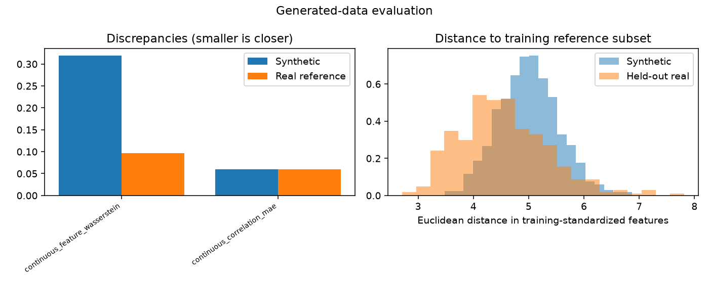

# Generative modeling evaluation

Evaluation mode: **validation**

Evaluation of saved training outputs.

AI interpretation: completed

Quality screens are predefined heuristics. Statistical similarity does not establish biological validity or privacy.

## realnvp_flow

Decision: **insufficient_evidence**

No downstream benefit was measured. These are development findings; a frozen final assessment is pending. Quality flags do not prove universal unusability.

Validity: passed

Output domain: log_dequantized_expression

Coverage of original plan: executable_contract_v2

Observed samples: {'training_reference': 1890, 'holdout': 405, 'generated': 1000}

#### Model-fit diagnostics

History: available; epochs observed: 9.

| Diagnostic | First | Last | Minimum (epoch) | Recent change |
|---|---:|---:|---:|---:|
| train_nll | 45.524 | 41.723 | 41.723 (9) | -2.4261 |
| validation_nll | 45.212 | 46.536 | 45.212 (1) | -0.017088 |

Recent change compares the last two to five available observations; it is not a significance test. Minima of GAN losses are descriptive, not optimal-quality checkpoints.

- NLL is for standardized continuous log-dequantized expression. Compare only identical features and preprocessing; it is not count likelihood or ELBO.
- Recent changes are descriptive, not significance tests. Improved model fit does not establish improved samples or downstream benefit.

### Sample-quality evidence

Threshold flags are exploratory workflow controls, not calibrated scientific acceptance boundaries.

| Discrepancy | Synthetic | Bootstrap 95% interval | Real-reference median (range) | Ratio | Exploratory flag |
|---|---:|---|---|---:|---|
| continuous_feature_wasserstein | 0.31979 | [0.3159684856751894, 0.34386479047039303] | 0.096676 ([0.08625727918039296, 0.10480248433262361]) | 3.3079 | fail |
| continuous_correlation_mae | 0.059685 | [0.0759658612900964, 0.0865280619723086] | 0.059249 ([0.05638226903373464, 0.06361574699671414]) | 1.0074 | pass |

Diversity ratio: 1.0384646974715035
Exact training-subset duplicate fraction: 0.0

Downstream evaluation: not_applicable

### AI interpretation

The generated array passes the recorded validity checks (1,000 observations, 32 features); this establishes structural validity only. Sample quality is mixed: continuous-feature Wasserstein discrepancy is 0.320 versus a real-reference median of 0.0967 (3.31 times higher), failing its heuristic screen. Correlation discrepancy is near the reference median (ratio 1.007), and diversity is similar by median distance (ratio 1.038); both pass their screens. The overall quality screen fails. No generated exact duplicates or near matches were recorded against the training reference subset, which does not establish privacy. Training NLL decreased from 45.52 to 41.72, while validation NLL ended above its epoch-1 minimum (46.54 versus 45.21). This divergence is consistent with a possible generalization gap, but does not establish its cause or explain sample quality. These NLL values describe standardized continuous log-dequantized expression, not count likelihood. Downstream utility was not evaluated, so justified use is limited to exploratory development and designing task-specific evaluations; these results establish no downstream or biological benefit. A frozen final assessment remains pending.

- Samples are continuous log(count + uniform jitter), not integer counts or library-normalized expression; exact zeros and count likelihood cannot be inferred.
- Quality comparisons use 405 matched samples. Bootstrap intervals condition on one fitted model and omit training-seed variation; reference ranges are not confidence intervals for differences.
- The correlation-discrepancy bootstrap interval [0.07597, 0.08653] excludes its reported point estimate 0.05969. Its uncertainty summary warrants checking before drawing inferential conclusions.
- Heuristic screens are exploratory, not empirically calibrated guarantees: failure does not prove universal unusability, and passing does not establish biological usefulness.
- Overlap checks cover only the recorded training reference subset and provide no privacy guarantee.
- Nine epochs of training and validation trends are development evidence, not final-test performance or proof of a training mechanism.
- No task-specific utility comparison or per-class quality results were supplied; continuous-expression similarity alone establishes no biological benefit.

### Limitations

- Subsampling caps and selected gene panels limit the scope of conclusions.
- Nearest-neighbor checks cover only the training reference subset and cannot establish privacy.
- Bootstrap intervals condition on one trained model and classifier fit; training variability is not included.
- Quality thresholds are heuristic; biological or perceptual validity requires additional evidence.

## Reproducibility

See evaluation_results.json, protocol.json, per-model evaluation_indices.npz and fitted_signature.txt for evidence, sample selection and frozen fitting signatures. Metric definitions and thresholds are in the recorded contract. No training files were overwritten.
