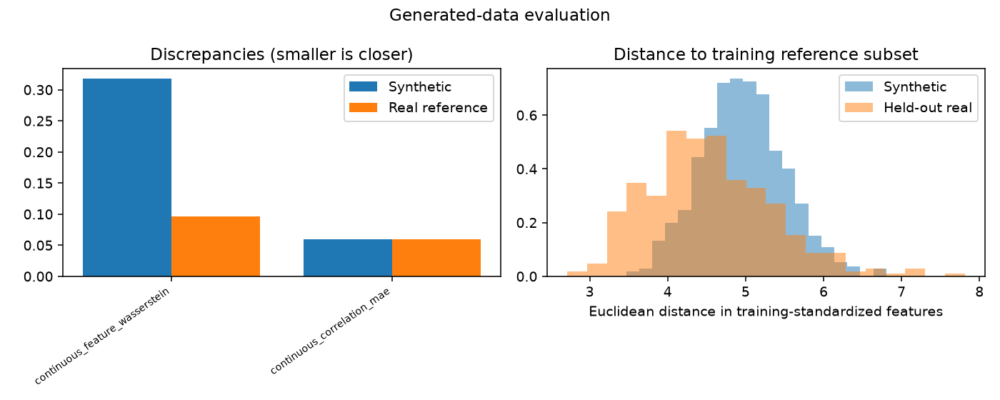

# Generative modeling evaluation

Evaluation mode: **validation**

Evaluation of saved training outputs.

AI interpretation: completed

Quality screens are predefined heuristics. Statistical similarity does not establish biological validity or privacy.

## realnvp_flow

Decision: **insufficient_evidence**

No downstream benefit was measured. These are development findings; a frozen final assessment is pending. Quality flags do not prove universal unusability.

Validity: passed

Output domain: log_dequantized_expression

Coverage of original plan: executable_contract_v2

Observed samples: {'training_reference': 1890, 'holdout': 405, 'generated': 1000}

#### Model-fit diagnostics

History: available; epochs observed: 10.

| Diagnostic | First | Last | Minimum (epoch) | Recent change |
|---|---:|---:|---:|---:|
| train_nll | 45.434 | 44.988 | 44.988 (10) | -0.2361 |
| validation_nll | 45.175 | 45.316 | 45.165 (2) | 0.1006 |

Recent change compares the last two to five available observations; it is not a significance test. Minima of GAN losses are descriptive, not optimal-quality checkpoints.

- **possible_overfitting**: Training objective decreased while validation objective increased over the recent window. This is compatible with overfitting, not proof of its cause. Consider a controlled capacity or optimization change; do not simply extend identical training.

- NLL is for standardized continuous log-dequantized expression. Compare only identical features and preprocessing; it is not count likelihood or ELBO.
- Recent changes are descriptive, not significance tests. Improved model fit does not establish improved samples or downstream benefit.

### Sample-quality evidence

Threshold flags are exploratory workflow controls, not calibrated scientific acceptance boundaries.

| Discrepancy | Synthetic | Bootstrap 95% interval | Real-reference median (range) | Ratio | Exploratory flag |
|---|---:|---|---|---:|---|
| continuous_feature_wasserstein | 0.31849 | [0.31455045301477524, 0.3421028362977368] | 0.096676 ([0.08625727918039296, 0.10480248433262361]) | 3.2944 | fail |
| continuous_correlation_mae | 0.059586 | [0.07582659259256391, 0.0864390093441713] | 0.059249 ([0.05638226903373464, 0.06361574699671414]) | 1.0057 | pass |

Diversity ratio: 1.0272096874486891
Exact training-subset duplicate fraction: 0.0

Downstream evaluation: not_applicable

### AI interpretation

Structural validity passed for 1,000 generated samples with 32 features. Outputs are continuous log(count + uniform jitter), not integer counts or library-normalized expression; exact zeros and count likelihood cannot be inferred. Sample quality is mixed: feature Wasserstein discrepancy was 0.3185 versus a real-reference median of 0.0967 (3.29 times higher), failing its heuristic screen. Correlation discrepancy was close to the reference median, diversity distance ratio was 1.027, and the correlation, diversity, and overlap screens passed. No exact training duplicates were detected against the recorded reference subset. These passes do not establish biological usefulness or privacy, and the failed aggregate quality screen does not establish universal unusability. Training NLL declined while validation NLL increased recently, a pattern compatible with possible overfitting but not proof of its cause. This NLL describes fit to standardized continuous expression only. No downstream benefit was measured; the justified use is exploratory development and task-specific evaluation, with frozen final assessment still pending.

- Quality screens are exploratory heuristics, not empirically calibrated guarantees of usability or biological benefit.
- Quality comparisons used 405 matched samples; bootstrap intervals condition on one fitted model and do not capture training-seed variation.
- The correlation discrepancy bootstrap interval [0.07583, 0.08644] excludes its reported point estimate of 0.05959; this discrepancy requires clarification before interpreting its uncertainty.
- Overlap checks cover only the recorded training reference subset and provide no privacy guarantee.
- Ten observed training epochs and descriptive validation trends cannot establish a causal training diagnosis or final-test performance.
- Downstream utility was not evaluated, so expression similarity alone justifies no claim of biological or task benefit.

### Limitations

- Subsampling caps and selected gene panels limit the scope of conclusions.
- Nearest-neighbor checks cover only the training reference subset and cannot establish privacy.
- Bootstrap intervals condition on one trained model and classifier fit; training variability is not included.
- Quality thresholds are heuristic; biological or perceptual validity requires additional evidence.

## Reproducibility

See evaluation_results.json, protocol.json, per-model evaluation_indices.npz and fitted_signature.txt for evidence, sample selection and frozen fitting signatures. Metric definitions and thresholds are in the recorded contract. No training files were overwritten.
